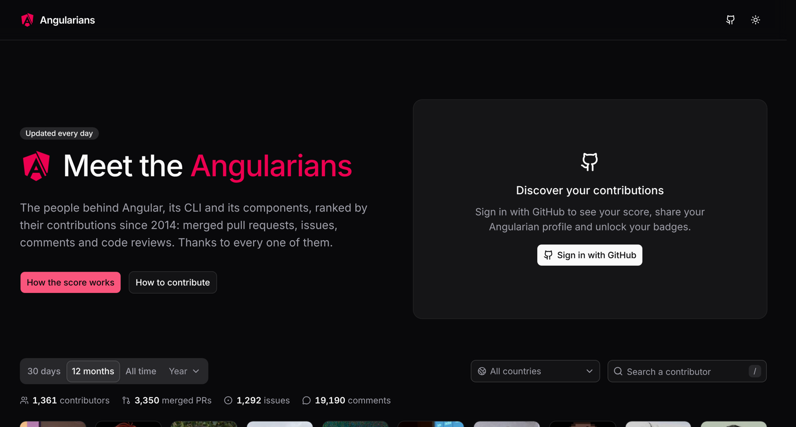

<p align="center"></p>

# Angularians

[](LICENSE)
[](https://github.com/sponsors/erkamyaman)

Everyone who has contributed to Angular since 2014, ranked. Inspired by [Nuxters](https://nuxt.com/nuxters), built for Angular.
Live at **[angularians.netlify.app](https://angularians.netlify.app)**, updated every night.

<p align="center">
  
</p>

## Quick start

You need Node 24 (`.nvmrc`) and pnpm 10.

```sh
git clone https://github.com/erkamyaman/angularians.git
cd angularians
pnpm install
pnpm dev     # http://localhost:5173, with the data in data/
pnpm test
```

The data is already in `data/`: you do not need a GitHub token to work on the site. To collect it yourself, see
[collector/README.md](collector/README.md).

## Features

- A leaderboard of [angular/angular](https://github.com/angular/angular), [angular/components](https://github.com/angular/components),
  [angular/angular-cli](https://github.com/angular/angular-cli) and [angular/dev-infra](https://github.com/angular/dev-infra): merged pull
  requests, issues, comments and code reviews. [How the score works](docs/SCORING.md).
- The last 30 days, the last 12 months, all time and every year, by country, with a globe.
- A profile for everyone: stats, badges, the packages they contributed to, year by year.
- Sign in with GitHub to see your rank, share your profile and add your Angularian card to your GitHub README.
- A public JSON API. How it all fits: [docs/ARCHITECTURE.md](docs/ARCHITECTURE.md).

## Contributing

See [CONTRIBUTING.md](CONTRIBUTING.md) and the [Code of Conduct](CODE_OF_CONDUCT.md). Report security problems through
[SECURITY.md](SECURITY.md).

## Maintainers

<!-- prettier-ignore-start -->
<table>
  <tbody>
    <tr>
      <td align="center" valign="top" width="14.28%"><a href="https://github.com/erkamyaman"><br /><sub><b>Erkam Yaman</b></sub></a><br /><sub>Maintainer</sub></td>
    </tr>
  </tbody>
</table>
<!-- prettier-ignore-end -->

## Contributors

Thanks to everyone who has helped. This project follows the [all-contributors](https://allcontributors.org) specification. Contributions of any kind welcome!

<!-- ALL-CONTRIBUTORS-LIST:START - Do not remove or modify this section -->
<!-- prettier-ignore-start -->
<!-- markdownlint-disable -->
<table>
  <tbody>
    <tr>
      <td align="center" valign="top" width="14.28%"><a href="https://github.com/erkamyaman"><br /><sub><b>Erkam Yaman</b></sub></a><br /><a href="https://github.com/erkamyaman/angularians/commits?author=erkamyaman" title="Code">💻</a> <a href="#design-erkamyaman" title="Design">🎨</a> <a href="https://github.com/erkamyaman/angularians/commits?author=erkamyaman" title="Documentation">📖</a> <a href="#infra-erkamyaman" title="Infrastructure (Hosting, Build-Tools, etc)">🚇</a> <a href="#maintenance-erkamyaman" title="Maintenance">🚧</a></td>
    </tr>
  </tbody>
</table>

<!-- markdownlint-restore -->
<!-- prettier-ignore-end -->

<!-- ALL-CONTRIBUTORS-LIST:END -->

## License

MIT License © 2026 [Erkam Yaman](https://github.com/erkamyaman). The code ported from Nuxters keeps the MIT notices of NuxtLabs and Nuxt:
[THIRD_PARTY_NOTICES.md](THIRD_PARTY_NOTICES.md).

Angularians is an independent community project. It is not affiliated with, or endorsed by, Google or the Angular team.
Angular is a trademark of Google LLC.
